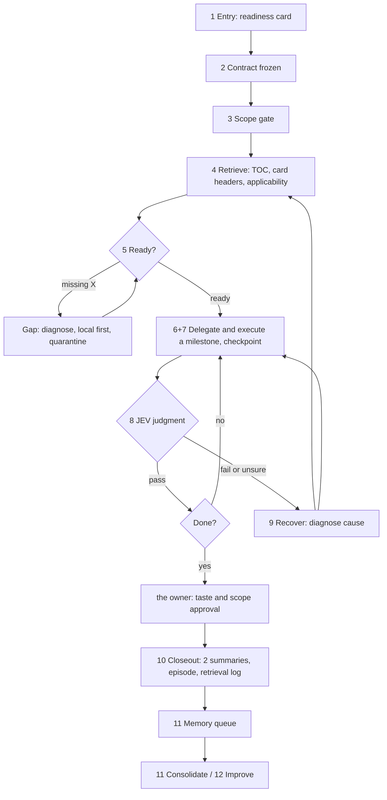

# Brain v2 map (Hydro Brain 2)

**Agent = model + harness.** Hydro Brain 2 (`v5`) builds on Agent Brain (`v3 Fable Art`) and Hydro Brain (`v4`) with unified IDF-indexed skill routing, completed Google Harness² (8 editable parts, EXPERIENCE library, auto-hypotheses), Karpathy LLM Wiki lint + autoresearch Gym tuning, fast post-session learning (`brain_learn.py`), and an idle-safe background Dreaming layer (`brain_dream.py`) that mines thinking logs and weaves missing knowledge nodes while keeping plain Markdown files, small stdlib Python tools, and clean scope boundaries. Obsidian is only the window the owner looks through ([[obsidian-or-own]]).

**Agents:** Claude Code director and Codex director. Argon is blocked by account location. Hermes was removed on 2026-11-08 (decisions-v2 D-015).

## The 14 layers + Hydro Brain 2 (v5) upgrades
| # | Layer | Its one job | Tool / Page |
|---|---|---|---|
| 0 | Integrity | Nothing is lost, every change can be undone (`_to_delete/`, install backups, LaunchAgent opt-in) | `hydro_install.py`, [[layer-00-integrity]] |
| 1 | Entry | Every session, from any folder, enters the same brain cheaply (card + sleep/dream status) | `brain_start.py`, [[layer-01-entry]] |
| 2 | Task contract | Freeze what was asked before work starts; smart re-route on lint diff | `brain_session.py`, [[layer-02-task-contract]] |
| 3 | Scope gate | Only the permitted kind of memory reaches the task; privacy filter in dream mining | `brain_fetch.py`, [[layer-03-scope-gate]] |
| 4 | Retrieval + Skills | Unified inverted-index skill ranking (`hydro_skills.py`: 2-char tokens, families, IDF floor, continuation) + notes | `hydro_skills.py`, `brain_route.py`, [[layer-04-retrieval-toc]] |
| 5 | Readiness + gap | Prove the task can be done and checked, or name what is missing; gap aggregation | `brain_dream.py`, [[layer-05-readiness-gap]] |
| 6 | Delegation (father-son) | Scoped subagents (`memory: project`, strict tool lists) fetch; director decides | `agents/*.md`, [[layer-06-delegation]] |
| 7 | Execution | Work in milestones with checkpoints and captured evidence; path-scoped rules | `.claude/rules/`, [[layer-07-execution]] |
| 8 | JEV judgment | Typed checks, `PAIR-BETTER`, >50% escalation monitor (`judge_typed.py status`), fast gate | `brain_judge.py`, `judge_typed.py`, `hydro_verify.py`, [[layer-08-jev-judgment]] |
| 9 | Recovery | Diagnose the cause, step back, restore (auto-rollback on broken dream edits) | `brain_dream.py`, [[layer-09-recovery]] |
| 10 | Closeout | Task Summary + Brain Summary from evidence, not memory | `brain_session.py close`, [[layer-10-closeout]] |
| 11 | Memory + Fast Learn + Dreaming | Immediate `brain_learn.py` + idle background `brain_dream.py` (thinking miner, missing-node graph weaver, self-citation audit) | `brain_learn.py`, `brain_dream.py`, [[layer-11-memory]] |
| 12 | Improve (Harness² + Gym) | 8-part `harness2.py` + EXPERIENCE library + live `gym.py` (`HS.CFG_OVERRIDE` ratchet) + daily sleep | `harness2.py`, `gym.py`, `brain_sleep.py`, [[layer-12-improve]] |
| 13 | Accounting | Measure tokens, skill picks, reasoning/thinking blocks, and the owner's effort from real logs | `brain_hooks.py`, `token_meter.py`, [[layer-13-accounting]] |
| + | Hallucination guard | Provenance & non-self-citation checks across every synthesis note | `vault_audit.py`, [[hallucination-audit]] |

## One session through the brain

## Three lanes (chosen in the contract, never silently downgraded)
| Lane | When | What runs |
|---|---|---|
| Fast | Small, reversible, low consequence (a lookup, a typo) | Entry, one-line contract, Tier-0 checks, one-line episode. No judge, no lesson |
| Standard | A normal deliverable | Every layer; Tier-1 judge, Tier-2 only when unsure |
| Deep | Official documents, engineering, public release, anything costly to get wrong, or brand-new territory | Every layer + readiness report to the owner before work, milestone judging, Tier-2 on all hard requirements, in-task Harness² allowed |

## Five loops
Retrieval (find → use → log what helped) · Execution (milestone → check) · Verification/recovery (judge → diagnose → fix or restore) · Knowledge maintenance (Karpathy's ingest, query, lint) · Controlled improvement (Harness² + autoresearch ratchet).

## Four memory states
Working state (this session) → Episode (what really happened) → Candidate (proposed lesson, with evidence) → Released (tested, scoped, versioned). Capture is immediate; generalization must be earned. → [[layer-11-memory]]

Folders: [[file-layout-v2]] · Build order: roadmap-v2 · Every flaw and where it is fixed: flaw-register
