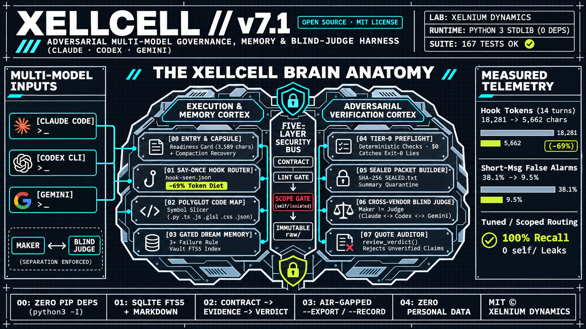

<p align="center">
  
</p>

<h1 align="center">XellCell</h1>

<p align="center"><b>A governance, memory and blind-judge harness for coding agents.</b><br>
Claude Code and Codex work inside it; a different vendor's model judges the result; deterministic code checks the judge.</p>

<p align="center">
  
  
  
  
  <a href="https://m8ven.ai/mcp/xelnium-dynamics-xellcell-u1a2bi?s=readme"></a>
</p>

<p align="center"><i>Coding agents shouldn't grade their own homework.</i><br>XellCell v7.1 · by <b>Xelnium Dynamics</b> · free and open source</p>

---

## Why it exists

A coding agent plans the work, does the work, and then writes the report that says the work is done. On real projects that loop fails in four ways:

1. **It grades itself.** "All tests pass" and "verified" come from the same model that wrote the code.
2. **It forgets.** A long session gets compacted, and the agent re-derives what it already knew, or contradicts it.
3. **It drowns in context.** Skill lists, notes and reminders are injected on every message, whether or not they are needed.
4. **Its memory fills with noise.** One failed command, half a sentence of reasoning or a coincidental keyword becomes a "lesson" that steers later sessions.

XellCell is a layer of hooks, small command-line tools and a Markdown + SQLite knowledge store that sits around the agent and closes those gaps. It contains no model of its own and makes no network calls; the only model calls it ever makes are the judge rounds you start, through the Claude or Codex CLI you already have.

## What a session looks like

| Step | What happens | Enforced by |
|---|---|---|
| 0 Entry | A short readiness card is injected at session start. After a compaction the agent gets a **capsule** instead: goal, requirements, last checkpoints, files touched, open errors, the judge's fix list. | `brain_start.py`, `brain_session.py capsule` |
| 1 Contract | The task is written down as `contract.md`: the request verbatim, hard requirements each with a check, constraints quoted from the request. **File edits are blocked until it is filled.** | `brain_session.py lint`, the `pre` hook |
| 2 Retrieve | Notes and skills that fit the contract are offered, once, as pointers. | `brain_route.py`, `hydro_skills.py` |
| 3–4 Map and delegate | Code is read by symbol, not by file. Subagents (Claude) search, verify, edit routine changes and draft summaries under strict output contracts. | `brain_map.py`, `agents/` |
| 5 Work | Milestones are checkpointed; every shell command and edit is logged as evidence by the `post` hook. | `brain_session.py checkpoint`, `brain_hooks.py post` |
| 6 Judge | Tier-0 checks run first. Then a **different vendor's** model judges a sealed brief, blind. Code checks the judge's answer. | `tier0.py`, `brain_judge.py` |
| 7 Close | Two summaries, at most one proposed lesson, a ledger entry, skill telemetry. Standard and deep work cannot close without a verdict, or a recorded reason. | `brain_session.py close`, `brain_learn.py` |
| 8 Sleep and dream | A daily job turns queued lessons into candidates for a human to approve; an optional idle job writes reflections and link suggestions as logs. | `brain_sleep.py`, `brain_dream.py` |

Small, reversible changes take a **fast lane** (one command opens and closes it). Questions and anything that changes no file need no session at all.

## The parts

### The judge brief (`brain_judge.py`)
The judge is told exactly what it received, what the goal was, and what went wrong:

- **0 Manifest:** every input with its size, its SHA-256 prefix, and whether it is shown in full, as an excerpt (with the cut characters named) or not inlined, plus the path of its sealed copy (`./artifacts/NN-name`, listed in `artifacts/SEALED.txt`). Nothing is cut silently.
- **1 Goal:** the frozen contract and a requirement ledger: id, text, its check, its Tier-0 result.
- **2 Errors:** failed checks, shell results from the evidence log that look like errors (and whether a clean rerun followed), and what the **previous round** found, to be re-checked item by item.
- **3 Changes:** files the session edited, and which of them were *not* submitted.
- **4 Lenses:** what usually goes wrong in this kind of work (`judge/lenses.json`): hints for flaws, never a reason to fail a requirement.

The maker's own summaries go in last, labelled as claims. Checkpoints and chat never go in.

Then **code checks the judge** (`review_verdict()`):

- a requirement without a verdict becomes `not_checked`;
- `pass` next to any open requirement becomes `inconclusive`;
- `pass` above a failed blocker becomes `fail`;
- a `pass` whose quoted evidence appears neither in the packet nor in the artifacts becomes `inconclusive`. Each quote is checked on its own, so one real quote cannot cover an invented one.

A Tier-0 check that exits 0 while printing an error is shown as `PASS?`, not as proof.

`--preflight` does the free part (Tier 0, unseen and unsubmitted files) without calling a model.

`--export DIR` writes the same brief, schema and sealed copies as files, so **any model can judge by hand**, Gemini included. `--record FILE` then files its answer as a normal round, with Tier 0 run again and the same code checks applied.

### The token layer
- **Say-once hooks.** A reminder, a skill or a note is injected the first time it applies to a conversation, and again only when the state changes or 8 messages later. Machine-generated messages and small talk get nothing.
- **Compaction capsule.** After `/compact`, the session's capsule (≤ 2,400 characters, built from records, never from memory) replaces the full card.
- **Project map** (`brain.py map`). `query`, `outline`, `slice`, `who` over Python (via `ast`), JS/TS, HTML (inline scripts with real line numbers), CSS, GLSL, Markdown and JSON. It is incremental, deterministic and free. Answers are pointers like `src/main.js:L47-L51`, so an agent reads one function instead of a 3,000-line file.
- **Section reads.** `brain.py fetch --outline | --section` returns a note's headings or one section of it.

### Memory with quality gates
- At most three queued lessons per session, and only what the agent proposed as a lesson. Gotchas go to a searchable ledger, not to the human's approval queue.
- Reflections are whole sentences. A failed command becomes a pattern only when its signature **repeats**. Link suggestions need a shared title or tag word.
- Dream output is a log, never a retrieval answer. It edits notes only on an explicit `--apply-links`.
- A skill counts as "used" when its `SKILL.md` was read, not when its name appears as an ordinary word in a summary.

### Gates (`brain_hooks.py pre`)
- **Contract gate:** edits and writing shell commands wait for a filled contract.
- **Scope gate:** `Brain System/self/` is readable only in a `personal` or `cv_official` session, including indirect reads through `grep -r`, globs and symlinks.
- **Evidence gate:** `raw/` is read-only.
- **ACTION-RISK:** push, publish, send, delete and install commands ask the human.
- **PRIVACY-LEAK:** web queries carrying e-mail addresses, phone or ID numbers or listed private terms are refused.

A gate that crashes logs the error and the others still decide; the start card shows recent hook errors.

## Measured, not claimed

Every number below comes from a file in `versions/` that was written by a command, not typed by hand.

| Measure | Before (v5) | XellCell v7.1 | Evidence |
|---|---|---|---|
| Hook text injected over a 14-message working session | 18,281 chars | 5,662 chars (−69%) | `versions/v7-xelcell/evidence/measure-v7.json` |
| Readiness card at session start | 3,828 chars | 3,589 chars | same |
| The owner's real short messages (≤ 4 words) that pulled in a skill list | 8 of 21 (38.1%) | 2 of 21 (9.5%) | `versions/v7-xelcell/evidence/real-traffic-compare-scoped.json` |
| The owner's 63 real task requests: skills offered | — | identical to v5 for 63 of 63 | same |
| Requests where the owner confirmed a right skill was offered | — | 13 of 18 labelled | `versions/v7-xelcell/evidence/owner-labels-2026-11-14.json` |
| Reviewer-written holdout prompts: recall · false alarms | 32/40 · 11/20 | 32/40 · 2/20 | `versions/v6-clearwater/evidence/route-eval-holdout.txt`, `versions/v7-xelcell/README.md` |
| Test suite | 111 | 172, all passing | `bash tools/test_all.sh` |

What these numbers do **not** say: the router is not smarter than before. For real task requests it offers what v5 offered. What changed is that small talk stays quiet and the measurement now includes real prompts.

## How it was built: models auditing each other

The commit history is short, but the record in `versions/` is not:

- **v4–v5 (built by Gemini).** It reported 88/88 routing recall. Ten of the thirty "negative" test prompts had been written into the router's own regex; on unseen prompts false alarms were 11 of 20. Its idle "dream" job filed half-sentences and coincidental word overlaps as memory, and was set to edit notes unattended.
- **v6 "Clearwater" (review and surgery by Claude).** It added the judge brief, the token layer, memory gates and blind holdouts. It also added an English verb/-ing matching rule that passed its own unit tests. Replaying the owner's 63 real requests showed the rule changed the offered skills for 32 of them, with no way to tell better from worse, so the rule was withdrawn.
- **The judge rounds on v6:** three by Codex (fail · inconclusive · fail), each finding real defects in the new judge code, and one by an external model run by hand through `--export` / `--record`: pass on all seven requirements, with eleven notes.
- **v7 "Xelcell"** fixed those notes. **v7.1** added the routing verdict from the owner's own labels.

The full write-ups: [`versions/v6-clearwater/README.md`](versions/v6-clearwater/README.md) and [`versions/v7-xelcell/README.md`](versions/v7-xelcell/README.md). Every new behaviour is mapped to its test in the `TESTMAP.md` files.

## Quick start (about 5 minutes)

Requirements: macOS or Linux, Python 3.9+, and Claude Code and/or the Codex CLI. No `pip install`, no `npm install`.

> **On Windows?** Use the **Windows edition** on the [`windows` branch](https://github.com/xelnium-dynamics/xellcell/tree/windows): same engine, Windows file locks, PowerShell-aware gates, Task Scheduler for the idle job, and a test run on Windows, Linux and macOS for every change. `git clone -b windows https://github.com/xelnium-dynamics/xellcell.git`

```bash
git clone https://github.com/xelnium-dynamics/xellcell.git ~/xellcell
cd ~/xellcell
bash tools/test_all.sh                 # 172 tests, about 1-2 minutes
python3 -I tools/brain_index.py        # indexes YOUR skills and the vault (index/ and 00-toc/ stay local)
python3 -I tools/brain_start.py --agent claude --format text   # the readiness card
```

**Hook it into Claude Code:** merge `examples/claude-code-settings.hooks.json` into `~/.claude/settings.json`. Optionally copy `agents/*.md` to `~/.claude/agents/` for the subagents.

**Hook it into Codex:** merge `examples/codex-hooks.json` into `~/.codex/hooks.json`, then approve the hooks when Codex asks you to trust them.

**Point both at the protocol:** add the few lines from `Brain System/system/boot/global-pointer.template.md` to `~/.claude/CLAUDE.md` and `~/.codex/AGENTS.md`, with `{{BRAIN_ROOT}}` replaced by your path.

The examples assume the repo lives at `~/xellcell`. If you cloned it elsewhere, change `$HOME/xellcell` in `examples/` and `agents/`.

**First session:**
```bash
B="python3 -I $HOME/xellcell/tools/brain.py"
$B new --agent claude --cwd "$PWD" --title "Add dark mode" --request "add a dark mode toggle to the settings page"
# fill sessions/<id>/contract.md (requirements with checks), then:
$B lint --session <id>
$B checkpoint --session <id> --note "toggle wired, tests green"
$B preflight --session <id> --artifacts src/settings.tsx
$B judge --session <id> --artifacts src/settings.tsx     # Claude's work is judged by Codex, and the other way round
$B close --session <id>
```

## Bring your own skills

XellCell ships **no skills**, by design. It indexes the skills you already have:
- `~/.claude/skills` and your Claude Code plugins;
- `~/.codex/skills`, `~/.codex/skills-library` and Codex plugins;
- `~/.agents/skills`.

It offers them per task, once, as pointers. Nothing is preloaded. Add your own folders in `state/skill-roots.json`.

To see how the router treats *your* prompts:

- `python3 -I tools/route_real.py --sheet reports/route-labels.md` writes a tick sheet with your own past requests (local, git-ignored);
- `--labels` scores the router against your ticks;
- `route_eval.py --holdout` reports any prompt sets you keep as `state/eval/prompt-skills-holdout*.json` (the v6 sets are kept as evidence in `versions/v6-clearwater/evidence/holdouts/`).

None of these gate anything, so nobody tunes against them.

## Configuration

| File | What it controls |
|---|---|
| `judge/config.json` | judge models (`claude_model`, `codex_model`) and timeout |
| `judge/lenses.json` | what the judge looks for per kind of work: engineering, website, brand, research, system |
| `state/vault-policy.json` (optional; see `examples/vault-policy.example.json`) | scripts or rules your vault forbids. Without it every language is allowed. |
| `state/harness-config.json`, `state/synonyms.json`, `state/skill-families.json` | router thresholds, vocabulary and optional skill families (empty by default); the Gym (`tools/gym.py`) tunes the thresholds against your eval sets |
| `BRAIN_HOOK_VERBOSE=1` | repeat skills and notes on every message (the old behaviour) |
| `BRAIN_TIER0_TIMEOUT` | time limit of a Tier-0 `cmd:` check (default 300 s) |

Claude Desktop (Chat or Cowork) has no hooks; `tools/brain_mcp.py` offers the same flow as a local MCP server.

## Your data stays yours

The repo contains the engine, the architecture notes (`Brain System/system/`), empty vault shelves and the version records. It contains **no skills, no sessions and no personal notes**.

`.gitignore` keeps everything you create local: sessions, queue, reports, indexes, your private `self/` shelf, your projects, history, lessons, judge logs and runtime state. Remove a line if you want to version your own notes.

## Limits, stated plainly

- **No "zero hallucination."** Claims are checked against records in three places: the verifier subagent or preflight, the close-time claim check, and the code review of the judge's answer. That lowers the rate; it cannot make it zero.
- **The project map follows names, not meaning:** no dynamic calls, no semantic grouping.
- **Hook adapters exist for Claude Code and Codex.** Other models take part as judges through `--export` / `--record`.
- **Router recall on real task requests is known only as far as someone has labelled them.** Use `route_real.py --sheet` on your own history.
- **This branch (`main`) is the macOS/Linux edition**, developed and tested on macOS. Windows users take the [`windows` branch](https://github.com/xelnium-dynamics/xellcell/tree/windows).

## Repository layout

```
tools/            the engine (Python stdlib), entry point tools/brain.py, tests in tools/tests/
agents/           Claude Code subagents: scout, hunter, worker, verifier, scribe
judge/            judge config, lenses, typed questions, schemas, privacy canaries
state/            router config and eval sets (runtime state is git-ignored)
Brain System/     the vault: system/ architecture notes, empty shelves for your notes
examples/         hook configs for Claude Code and Codex, vault policy example
versions/         v6 and v7 records: design, changelog, test maps, measured evidence
AGENTS.md         the protocol every session follows
```

## License

MIT © 2026 Xelnium Dynamics. See [LICENSE](LICENSE). Security model and reporting: [SECURITY.md](SECURITY.md).
